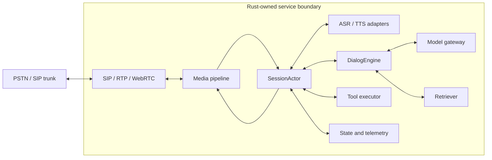

# Duplex Voice Runtime Specification

- Status: Draft
- Version: 0.1
- Repository root: `.`
- Primary language: Rust
- License: MIT OR Apache-2.0

## 1. Purpose

This project incrementally builds a real-time, full-duplex voice agent in Rust.
It begins with a typed text-dialog core and deterministic fake providers, then
adds speech, streaming media, telephony, observability, and fault tolerance.

The implementation must keep conversation correctness in Rust even when speech
or model inference is executed by native runtimes or remote services.

## 2. Goals

1. Assemble prompts, messages, variables, and history from immutable snapshots.
2. Provide a minimal speech-to-speech loop that can be verified locally.
3. Demonstrate one idempotent tool loop and one retrieval-assisted response.
4. Support streaming input and output with bounded memory use.
5. Support full-duplex listening and deterministic barge-in.
6. Isolate stale model and audio results with generation identities.
7. Connect to SIP telephony without coupling conversation logic to SIP details.
8. Commit conversation history only after authoritative playback disposition.
9. Scale from one in-process session to multiple service instances.
10. Leave clear extension points for outbound-calling product capabilities.

## 3. Non-goals

The first implementation does not attempt to provide:

- A carrier network, phone numbers, or SIP trunk service.
- A model training platform.
- A complete call-center product.
- Multi-region active-active deployment.
- A custom implementation of every codec or inference runtime.
- Speculative input preparation, candidate adoption, or same-round input
  replacement before the core delivery model is stable.
- Deployment-specific compatibility adapters before the standalone runtime is
  behaviorally stable.

## 4. Engineering principles

### 4.1 Rust owns correctness

Rust code owns:

- Session and round state.
- Cancellation and timeout policy.
- Request and generation identity.
- Barge-in arbitration.
- Playback eligibility.
- Delivery commit eligibility.
- Backpressure and resource limits.
- Error normalization and telemetry.

Native libraries and remote providers perform bounded computations. They must
not become the source of truth for conversation state.

### 4.2 One state owner per call

Each call has one `SessionActor`. Media, ASR, dialog, model, TTS, storage, and
telephony tasks communicate with it through typed events. Those tasks do not
mutate session state directly.

The `DialogEngine` consumes an immutable `DialogSnapshot` and produces typed
decisions. The `SessionActor` validates and admits those decisions before they
can change effective runtime state.

### 4.3 Bounded concurrency

Every queue is bounded. Every external operation has a timeout or cancellation
path. Slow consumers must cause backpressure, dropping under an explicit policy,
or a bounded session failure.

### 4.4 Identity before cancellation

Cancellation is best-effort resource cleanup. Correctness comes from checking
the identity attached to every result:

- `session_id`
- `main_round`
- `request_id`
- `input_revision`
- `generation`
- `delivery_identity`
- `tool_execution_id`
- `attempt_id`

Late output with stale identity cannot regain playback, continuation, or other
user-visible eligibility even if cancellation failed. Settlement facts are
different: a late playback terminal or an already admitted tool outcome may
still update the delivery record or tool ledger identified by its original
identity, but it cannot reactivate that generation.

### 4.5 Persist only authoritative facts

Generated text is not automatically delivered text. A text-only test uses an
explicit fake delivery sink; an audio runtime uses evidence from its playback or
transport adapter. Writing `output.wav` proves synthesis completion only and
does not prove playback. Conversation history advances only after the applicable
delivery sink reports an authoritative terminal disposition.

### 4.6 Side effects are explicit

Discarding a stale result does not undo a side effect that already happened.
Every effectful tool call has an execution identity, an idempotency policy, an
admission point before execution, and an outcome that can remain unknown.

## 5. System boundary



Native execution may exist behind a Rust adapter:

```text
Rust business code
  -> safe Rust crate
  -> FFI / C ABI
  -> C, C++, ONNX Runtime, libopus, or CUDA
```

The preferred alternative for an unstable or heavyweight native runtime is a
separate process reached over gRPC or WebSocket.

## 6. Target repository layout

The project starts as one package. It should become a Cargo workspace only when
the corresponding boundaries contain real code.

```text
duplex-voice-runtime/
  Cargo.toml
  README.md
  docs/
    spec.md
  src/
    main.rs
  crates/
    domain/       # IDs, events, states, invariants
    session/      # SessionActor and arbitration
    dialog/       # Prompt, messages, history snapshots, decisions
    model_gateway/ # LLM request conversion, streaming, routing, usage
    tools/        # Tool admission, execution identity, result messages
    retrieval/    # Retrieval decisions and context injection
    media/        # PCM frames, queues, resampling, codecs
    providers/    # ASR and TTS provider interfaces
    telephony/    # SIP/RTP/WebRTC adapters
    storage/      # History, Redis, SQL, and event export
    telemetry/    # Metrics, traces, and normalized failures
    testkit/      # Deterministic fake providers and event replay
```

## 7. Core domain model

### 7.1 Identities

```rust
struct SessionId(String);
struct RequestId(String);
struct MainRound(u32);
struct InputRevision(u32);
struct Generation(u64);
struct ToolExecutionId(String);
struct ToolAttemptId(String);
struct IdempotencyKey(String);
```

These must be distinct types rather than interchangeable strings or integers.
An execution ID and idempotency key identify one logical tool operation. Each
network or provider retry gets a new attempt ID while preserving those logical
identities.

### 7.2 Orthogonal session state

Full duplex cannot be represented by one mutually exclusive
`Listening / Thinking / Speaking` enum. A session uses independent projections:

```rust
struct SessionState {
    lifecycle: SessionLifecycle,
    input: InputState,
    output: OutputState,
    delivery: DeliveryState,
}

struct InputState {
    capture: TaskPhase,
    speech: SpeechPhase,
    recognition: TaskPhase,
}

struct OutputState {
    generation: TaskPhase,
    synthesis: TaskPhase,
    playback: PlaybackPhase,
}
```

Input recognition and output playback may therefore be active at the same time.
Transition methods still enforce cross-projection invariants.

### 7.3 Events

Minimum event set:

```rust
enum SessionEvent {
    MediaConnected,
    UserTextInput(UserTextInput),
    InputAudio(AudioFrame),
    SpeechStarted,
    SpeechEnded,
    AsrPartial(AsrPartial),
    AsrFinal(AsrFinal),
    DialogDecision(DialogDecision),
    RetrievalCompleted(RetrievalCompleted),
    ToolExecutionAdmitted(ToolExecutionPermit),
    LlmDelta(LlmDelta),
    LlmCompleted(LlmCompleted),
    TtsAudio(TtsAudio),
    TtsCompleted(TtsCompleted),
    PlaybackStarted(PlaybackStarted),
    PlaybackDispatched(PlaybackDispatched),
    PlaybackTerminal(PlaybackTerminal),
    ToolCompleted(ToolCompleted),
    ProviderFailed(ProviderFailed),
    HangupRequested,
    TransportClosed,
    TimeoutExpired(TimeoutKind),
}
```

Every provider result and output frame carries its correlation identity.

## 8. Required invariants

1. Exactly one task owns mutable session state.
2. `DialogEngine` decisions are inert until admitted by the `SessionActor`.
3. A generation increases whenever effective output is replaced or interrupted.
4. Only the current generation may enqueue playable audio.
5. Generation is checked again when audio crosses the transport dispatch
   boundary, under the same arbitration boundary used by interruption.
6. Audio already dispatched is immutable delivery evidence and is never
   reclassified as undispatched.
7. Old generation output never becomes eligible again.
8. Late settlement facts may close the original delivery or tool ledger, but
   they cannot produce playback, dialog continuation, or new side effects for a
   stale generation.
9. Cancellation failure does not restore stale output eligibility.
10. New logical inputs receive strictly increasing revisions that are never
    reused. Retrying or recovering the same logical operation preserves its
    logical identity and allocates a new attempt identity.
11. Effectful tools require a `ToolExecutionPermit` issued by the
    `SessionActor` before execution. The permit carries a `ToolExecutionId` and
    stable idempotency key.
12. A stale tool result cannot continue dialog, but an already executed side
    effect keeps its recorded `succeeded`, `failed`, or `unknown` outcome.
13. A `DeliveryIdentity` includes `session_id`, `main_round`, `request_id`, and
    `input_revision`.
14. Delivery handling is idempotent for one `DeliveryIdentity`, and each
    `MainRound` accepts at most one effective delivery record.
15. A delivery commit requires an authoritative terminal status from the active
    delivery sink.
16. Unknown playback outcome is not converted into a false success or failure.
17. Session shutdown drains or discards work according to an explicit policy.
18. No queue may grow without a configured bound.

## 9. Provider interfaces

Provider traits hide transport and runtime details.

```rust
trait DialogEngine {
    async fn decide(
        &self,
        input: DialogInput,
        snapshot: DialogSnapshot,
    ) -> Result<DialogDecisionStream, DialogError>;
}

trait AsrProvider {
    async fn start(&self, request: AsrRequest) -> Result<AsrStream, ProviderError>;
}

trait LlmProvider {
    async fn generate(
        &self,
        request: LlmRequest,
    ) -> Result<LlmStream, ProviderError>;
}

trait TtsProvider {
    async fn synthesize(
        &self,
        request: TtsRequest,
    ) -> Result<TtsStream, ProviderError>;
}

trait Retriever {
    async fn retrieve(
        &self,
        request: RetrievalRequest,
    ) -> Result<RetrievalResult, RetrievalError>;
}

trait ToolExecutor {
    async fn execute(
        &self,
        permit: ToolExecutionPermit,
    ) -> Result<ToolExecutionOutcome, ToolError>;
}
```

The exact trait syntax may use boxed streams or associated types. Provider
errors must be normalized into stable categories:

- `Timeout`
- `Canceled`
- `Unavailable`
- `RateLimited`
- `Authentication`
- `InvalidRequest`
- `InvalidResponse`
- `Protocol`
- `Internal`

### 9.1 Dialog snapshots

A `DialogSnapshot` contains the effective user input, delivered conversation
history, variables, prompt version, available tools, and retrieval policy. It
does not expose mutable session state.

### 9.2 Tool and retrieval semantics

Retrieval is generation-scoped, but normally has no external business side
effect. Its result must be explicitly selected and inserted into model messages.

Tool execution has a separate lifecycle:

```text
DialogEngine plans ToolExecutionRequest
  -> SessionActor validates identity and policy
  -> SessionActor issues ToolExecutionPermit
  -> ToolExecutor executes
  -> ToolCompleted returns to SessionActor
  -> SessionActor updates the ledger
  -> eligible result returns to DialogEngine for continuation
```

The executor accepts a permit rather than an untrusted plan, so it cannot bypass
admission. Interruption before admission prevents execution. Interruption after
admission may suppress the conversational result, but the tool outcome still
settles the original ledger and does not claim that the business effect was
rolled back.

## 10. Candidate open-source components

These are candidates, not permanent commitments. Versions are selected and
pinned during the phase that introduces them.

| Capability | Candidate |
| --- | --- |
| Async runtime | Tokio |
| HTTP/WebSocket | Axum, tokio-tungstenite |
| Cancellation | tokio-util `CancellationToken` |
| Audio buffers | bytes |
| WAV test input/output | hound |
| Resampling | rubato |
| VAD | Silero through `ort`, or sherpa-onnx VAD |
| Local ASR/TTS | sherpa-onnx Rust API |
| Cloud model access | reqwest, WebSocket, SSE |
| Agent/tool abstraction | Direct traits first; Rig is optional |
| SIP and RTP | rvoip-sip or RustPBX, not both initially |
| Database | SQLx |
| Cache/session coordination | redis-rs |
| Event stream | rust-rdkafka or async-nats |
| Telemetry | tracing and OpenTelemetry |

## 11. Incremental implementation plan

After Phase 0, the semantic track (Phases 1-2) and media track (Phases 3-4)
remain independently testable. Phase 5 is the convergence gate: SIP and durable
infrastructure are not introduced until dialog, streaming, interruption, and
delivery semantics work together in memory.

### Phase 0: Project foundation

Deliver:

- Cargo package and CI-friendly commands.
- Typed session, round, request, revision, generation, delivery, and tool IDs.
- Orthogonal input, output, lifecycle, and delivery state projections.
- A single-owner `SessionActor` event loop.
- Deterministic fake providers and event replay.
- Domain naming and error conventions.
- Configuration loading with no embedded credentials.
- Basic structured logging and correlation fields.

Introduce:

- `tokio`
- `serde`
- `thiserror`
- `tracing`
- `uuid`

Acceptance:

- `cargo fmt --check`, `cargo check`, and `cargo test` pass.
- Domain transition tests run without network or model dependencies.
- Replayed events produce deterministic state and accepted effects.
- Every spawned call-scoped task has an observable completion path.

### Phase 1: Text dialog engine

Deliver:

```text
user text
  -> immutable DialogSnapshot
  -> prompt and ordered messages
  -> fake or remote model stream
  -> assistant decision
  -> explicit fake delivery sink
  -> in-memory delivered history
```

Introduce:

- Direct `DialogEngine` and model-gateway traits
- `serde_json`
- `reqwest` only when the first remote model adapter is added

Acceptance:

- Tests show exactly how prompt, variables, history, and user input become model
  messages.
- Generated assistant text is not added to delivered history until an explicit
  fake delivery sink confirms its terminal disposition.
- The dialog flow runs entirely with deterministic fakes.

### Phase 2: Minimal tool and retrieval loop

Deliver:

- One read-only fake retriever whose selected result is inserted into messages.
- One idempotent fake tool with schema, argument validation, admission, result
  message, and model continuation.
- Tool execution identity and explicit `unknown` outcome.

Introduce:

- No vector database or real business API.
- Schema helpers only if direct Rust types become insufficient.

Acceptance:

- Tests distinguish retrieval success, context selection, message injection, and
  grounded response generation.
- Fake retrieval validates data flow and context injection, not real recall
  quality or answer correctness.
- Interrupting before tool admission prevents execution.
- The fake executor rejects any request without an actor-issued permit.
- Interrupting after admission does not claim the effect was rolled back.
- Repeated idempotency keys do not duplicate the fake business effect.

### Phase 3: Offline speech loop

Deliver:

```text
input.wav
  -> ASR
  -> DialogEngine
  -> model
  -> TTS
  -> output.wav
```

Introduce:

- `hound`
- `sherpa-onnx` or one remote ASR/TTS adapter
- The first audio format and resampling contracts

Acceptance:

- A fixed input file produces a non-empty transcript, dialog decision, and
  output audio file.
- Writing `output.wav` proves synthesis completion only. An explicit fake
  playback sink is required before the test can advance delivered history.
- Provider failures are returned as normalized errors.
- Audio adapters remain outside prompt, history, and tool logic.

### Phase 4: Real-time streaming

Deliver:

- WebSocket PCM ingress and egress.
- Fixed audio-frame format and timestamps.
- Bounded ingress, provider, and playback queues.
- Streaming ASR partial/final results.
- Streaming LLM output.
- Sentence or clause segmentation for TTS.
- Streaming TTS audio.

Introduce:

- `axum`
- `tokio-tungstenite`
- `bytes`
- `rubato`
- Tokio bounded `mpsc`
- SSE or WebSocket provider clients
- Optional Rig adapter after direct provider traits are stable

Acceptance:

- A client can continuously send and receive audio frames.
- Playback can begin before the complete LLM response exists.
- Slow output consumption does not cause unbounded memory growth.
- Disconnecting the client terminates all call-scoped tasks.
- Stage latency is emitted for ASR, LLM, TTS, and playback.

### Phase 5: Full duplex, barge-in, and delivery semantics

Deliver:

- Continue listening while output audio is playing.
- VAD speech-start and speech-end events.
- Input revision and generation-scoped dialog, model, TTS, and playback.
- Cancellation and playback queue flush on accepted barge-in.
- Atomic arbitration between interruption and actual audio dispatch.
- In-memory delivery records keyed by `DeliveryIdentity`.
- Delivered history derived from playback evidence.

Introduce:

- Silero VAD through `ort`, or sherpa-onnx VAD
- `tokio-util::CancellationToken`

Acceptance:

- User speech during playback causes an observable interruption.
- Generation is checked both before enqueue and at transport dispatch.
- No old-generation audio crosses the dispatch boundary after interruption wins.
- Audio already dispatched remains delivery evidence.
- A late playback terminal for an interrupted generation may settle its original
  delivery record without restoring playback eligibility.
- Delivery acceptance is idempotent for one identity, and a round accepts at
  most one effective delivery record.
- Event replay covers speech-start versus first-audio dispatch races.

### Phase 6: Persistence, configuration, and event records

Deliver:

- Durable history derived from the accepted in-memory delivery record.
- Immutable per-session configuration and prompt-version snapshots.
- A tool execution ledger with idempotency and unknown outcomes.
- Durable event records and an outbox-style callback boundary.

Introduce:

- SQLx for durable history.
- redis-rs only if cross-process session coordination is required.

Acceptance:

- Replaying one delivery identity does not duplicate durable history.
- Interrupted output persists only the authoritative delivered prefix.
- A session never observes a mid-call prompt or policy mutation.
- New logical inputs and tools receive new identities. Retrying or recovering
  one logical operation preserves its revision or execution ID and idempotency
  key while allocating a new attempt ID.
- Callback transport success remains distinct from business acceptance.

### Phase 7: Telephone integration

Deliver:

- SIP registration or trunk connectivity.
- Inbound and outbound call control.
- RTP media with G.711 as the initial codec.
- DTMF and authoritative hangup handling.
- Adapter from telephony events to `SessionEvent`.

Introduce one:

- `rvoip-sip` for an embedded Rust stack, or
- RustPBX as a separate Rust PBX process.

Introduce an external dependency:

- A SIP trunk or test PBX. PSTN numbers and carrier service are outside this
  repository.

Acceptance:

- A real or test SIP endpoint can place and receive a call.
- Two-way audio, DTMF, barge-in, and hangup work.
- Telephony reconnect or duplicate events do not create duplicate sessions.
- The telephone adapter does not own dialog, generation, or delivery truth.

### Phase 8: Reliability, performance, and multi-instance deployment

Deliver:

- Provider timeouts, concurrency limits, and circuit policy.
- Graceful shutdown and bounded draining.
- Health and readiness endpoints.
- Structured traces, metrics, and normalized error dimensions.
- Fault-injection and soak-test harnesses.
- Explicit session ownership and routing.
- External configuration and secret management.
- Durable event export.
- Container images and deployment manifests.
- Load and capacity tests.

Introduce as required:

- OpenTelemetry
- Prometheus exporter
- Tower timeout and concurrency middleware where appropriate
- `proptest` for invariant testing
- Redis
- rust-rdkafka or async-nats
- Docker
- Kubernetes

Acceptance:

- Slow or unavailable providers cannot hang a session indefinitely.
- Shutdown has a deterministic upper bound.
- A single call can be reconstructed from logs and traces.
- Fault injection covers disconnects, late results, duplicate events, tool
  outcome uncertainty, and provider stalls.
- Rolling deployment does not create two owners for one live session.
- Load shedding is explicit and observable.
- Capacity limits are measured for calls, audio bandwidth, and provider work.

### Phase 9: Outbound-calling product

Deliver:

- Campaign and contact-list management.
- Scheduling and dialing-rate control.
- Retry and disposition policy.
- Transfer-to-human workflow.
- Recording and CRM callbacks.
- Non-human-answer detection.
- Audit, blacklist, quiet-hours, and compliance controls.
- Prompt and model version rollout.

Acceptance:

- One outbound job forms a complete lifecycle from scheduling through call
  record and result callback.
- Retry, transfer, and terminal dispositions are idempotent.
- Operational and compliance actions are auditable.

## 12. Milestones

### MVP

Phases 0 through 5:

- Text dialog with explicit prompt and delivered history.
- One fake tool loop and one fake retrieval path.
- One real-time session.
- Full-duplex listening.
- Deterministic barge-in.
- Idempotent in-memory delivery.
- No telephony requirement.

### Portfolio-quality project

Phases 0 through 7:

- Real telephone call.
- Streaming ASR/LLM/TTS.
- Prompt, retrieval, and tool boundaries.
- Generation isolation.
- Delivery-based history semantics.
- Durable history and event records.

### Production candidate

Phases 0 through 8:

- Bounded failure handling.
- Observability.
- Multi-instance deployment.
- Capacity evidence.

Phase 9 is a product expansion, not a prerequisite for validating the core voice
agent runtime.

## 13. Non-functional requirements

### Performance

- Avoid blocking the async runtime with inference or codec work.
- Run blocking native calls on dedicated workers or `spawn_blocking`.
- Reuse model sessions only when the underlying runtime documents thread safety.
- Record queue residence time in addition to provider latency.

### Backpressure

- Use bounded queues with explicit overflow behavior.
- Audio queues prefer bounded real-time behavior over unlimited completeness.
- Control events must not be silently dropped.
- Provider streaming must stop reading when downstream capacity is exhausted.

### Security

- Do not log raw credentials, prompts, or complete audio payloads.
- Redact provider response bodies from authentication and protocol failures.
- Load credentials through environment or a secret provider.
- Authenticate management and telephony control endpoints.
- Validate frame lengths, sample rates, message types, and correlation identity.

### Native runtime isolation

- Centralize FFI behind provider or codec adapters.
- Pin the Rust crate and native library as one tested compatibility set.
- Document required `.so`, `.dylib`, or `.dll` files.
- Prefer a sidecar process if a native crash would have unacceptable blast radius.

## 14. Testing strategy

### Unit tests

- Orthogonal state projection transitions.
- Generation checks at enqueue and dispatch.
- Input revision allocation.
- Logical operation identity versus per-attempt identity.
- Delivery identity and idempotent acceptance.
- Dialog snapshot and message ordering.
- Tool admission, idempotency, and outcome uncertainty.
- Retrieval selection and message injection.
- Queue overflow policy.
- Error normalization.

### Event replay tests

Replay deterministic sequences such as:

- Speech starts before first audio dispatch.
- Speech starts after first audio dispatch.
- TTS sends audio after cancellation.
- Old audio was queued before interruption but reaches the dispatch gate later.
- A tool is interrupted before admission.
- A tool side effect completes after its conversational generation becomes stale.
- A late playback terminal settles an interrupted generation without reactivating
  it.
- A retried tool keeps its logical identity and uses a new attempt identity.
- Playback terminal arrives twice.
- Transport closes before delivery becomes decidable.
- New input arrives while a prior delivery commit is pending.

### Integration tests

- Fake streaming ASR, LLM, and TTS servers.
- Fake retriever and effectful tool executor.
- Fake text and audio delivery sinks.
- WebSocket media client.
- SIPp or a test PBX for SIP behavior.
- SQL and Redis test containers when those phases are introduced.

### Load and fault tests

- Concurrent sessions with bounded queues.
- Slow provider streams.
- Partial provider responses.
- Network disconnect and reconnect.
- Process shutdown during active playback.
- Native runtime timeout or worker crash.

## 15. Configuration

Initial configuration groups:

```text
server
dialog
model_gateway
tools
retrieval
media
vad
asr
llm
tts
telephony
storage
telemetry
limits
timeouts
```

Configuration is parsed into typed immutable session snapshots. Dynamic updates
must not silently change the policy of a call already in progress.

## 16. Open decisions

These decisions are intentionally deferred until their implementation phase:

1. Embedded `rvoip-sip` versus separate RustPBX process.
2. Local versus remote ASR for the first streaming implementation.
3. Local versus remote TTS for the first streaming implementation.
4. Direct LLM adapter versus Rig.
5. Real retrieval backend and context-selection policy.
6. Real tool transport and business idempotency contract.
7. SQL schema and history projection format.
8. Redis requirement and session-ownership protocol.
9. External dialog-service protocol compatibility strategy.
10. Browser WebRTC support and TURN deployment.
11. Speculative input preparation, candidate adoption, and same-round input
    replacement after the core path is stable.

Each decision requires a short spike, a recorded result, and tests at the chosen
boundary before it becomes part of the stable architecture.

## 17. Immediate next work

The first implementation increment should:

1. Convert the package into a small modular layout.
2. Add typed identities, orthogonal state projections, and provider errors.
3. Implement `SessionActor` with deterministic event replay.
4. Add fake model, tool, and retrieval providers.
5. Implement the text-only `DialogEngine` and delivered-history boundary.
6. Add unit tests before introducing audio dependencies.
